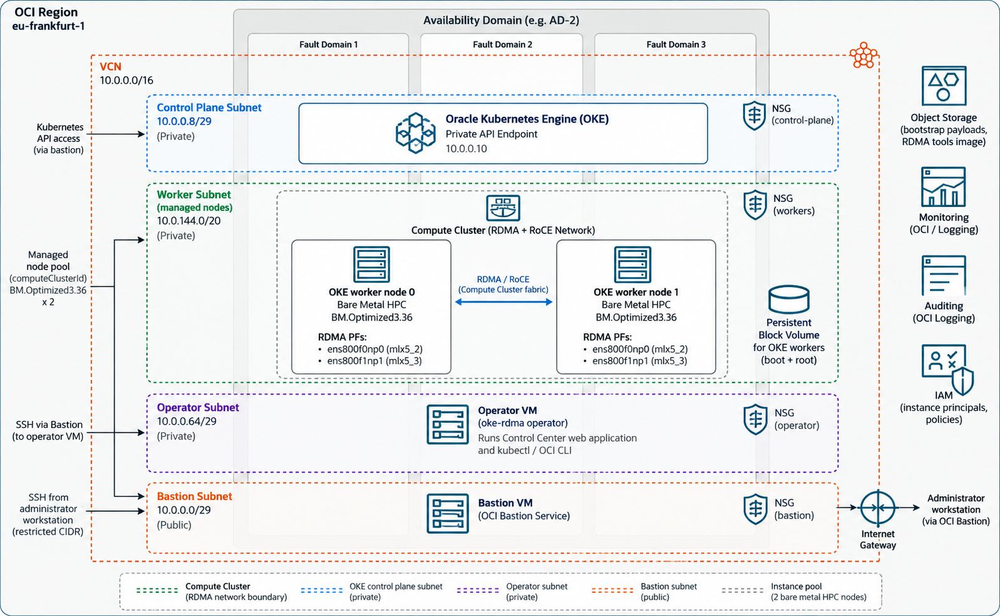

# OKE HPC Control Center

Provision a private OCI Kubernetes environment for CPU RDMA workloads, then configure and validate it through the UI or operator VM.



The diagram illustrates the topology. See [architecture details](docs/ARCHITECTURE.md#reading-the-diagram) for the deployed services and subnet defaults.

## 1. Prepare

Have your OCI compartment, region/availability domain, SSH key pair and required [IAM permissions](docs/IAM.md) ready. [Import an Ubuntu 24.04 or 22.04 HPC worker image](docs/CUSTOM-IMAGES.md) and select an approved operator image. Start with **two workers** for cross-node testing. Provisioned resources incur OCI charges.

## 2. Build the Resource Manager ZIP

On Linux or WSL, install Git, Python 3, Bash, `curl`, `tar` and `sha256sum`. Run:

```bash
git clone https://github.com/dezma/oci-hpc-rdma-oke.git
cd oci-hpc-rdma-oke
chmod +x provisioning/*.sh control/bootstrap/*.sh
bash provisioning/build-orm.sh
(cd dist && sha256sum -c SHA256SUMS)
```

The generated file is **`dist/oci-oke-rdma-quickstart-orm-v<VERSION>.zip`**, using the version in `VERSION`. Wait for the build to succeed and checksums to report `OK`. Building needs internet access but does not require Terraform, Docker or OCI credentials.

## 3. Create and apply the stack

In OCI Console, open **Resource Manager → Stacks → Create stack**:

1. Upload the generated **ORM ZIP**, not the GitHub source ZIP.
2. Select a service-supported Terraform version **1.5.7 or later**. Newer versions are allowed by the configuration but have not all been tested.
3. Set the compartment, region, AD, worker shape/count, compatible worker image and OKE version. Select and pin the approved operator image using its image-name dropdown.
4. Review network, access and IAM settings. Reuse administrator-provided policies/groups when you cannot create them.
5. Create the stack without Apply. For UI scaling, set **Owning Resource Manager stack OCID** to this stack's OCID in its variables and configure the required scaling permissions.
6. Run **Plan**, review the resources and images, then run **Apply**. Wait for success and open **Outputs**.

See [provisioning details](docs/PROVISIONING.md) for field explanations and [deployment requirements](docs/DEPLOYMENT.md) for image/network prerequisites.

## 4. Connect to the operator and UI

Use the stack Outputs to create Bastion SSH and UI forwarding sessions. Run the connection commands on your workstation with your matching private key. Forward local port **18000** to operator port **8000**, keep the tunnel open, and browse to **http://127.0.0.1:18000**.

Retrieve the login token in the operator SSH session:

```bash
sudo cat /etc/oke-rdma-control/admin.token
```

For the full connection sequence, see [private access](docs/PROVISIONING.md#3-connect-privately).

## 5. Prepare the tools image

On the **operator VM**, follow [image and registry setup](docs/IMAGE-PULL-SECRET.md): build and verify the image, log in to OCIR, push it, record its digest, and create the image pull secret in both namespaces.

## 6. Validate and run workloads

In **Setup & validation**, save the image digest and RDMA settings, check hosts, enable Dranet, and run the quick cross-node test. Once validation passes, download the workload YAML and use it to deploy your workload.

Follow the [UI guide](docs/UI.md) or [operator VM guide](docs/OPERATOR-VM.md) for these operations. If a step fails, start with [troubleshooting](docs/TROUBLESHOOTING.md).

For ongoing health checks and alerts, enable [monitoring](docs/MONITORING.md) after validation passes. See the [documentation index](docs/README.md) for all guides.
